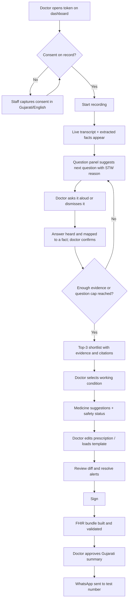
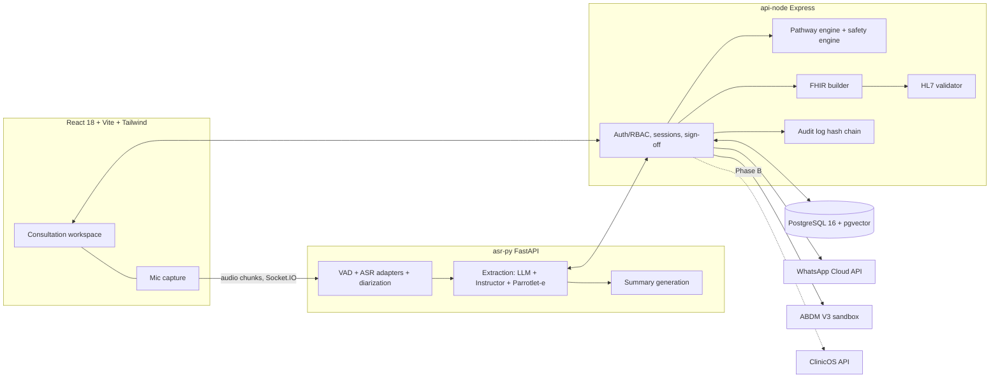

# VaaniEHR — Product Requirements Document (PRD)

| | |
|---|---|
| **Product** | VaaniEHR — voice-assisted, guideline-grounded, ABDM-ready consultation module |
| **Document version** | 1.0 (build-ready draft) |
| **Date** | 14 October 2026 |
| **Author** | Ansh Raythatha (B.Tech ICT, Marwadi University, Rajkot) — Course 01CT2801 "Project", Sem VIII |
| **Status** | Faculty-approved concept; pre-build |
| **Audience** | Faculty guide and review panel, developers, AI coding tools |
| **Companion document** | SRS (IEEE 29148 structure) — this PRD is its source of requirement IDs (`FR-*`, `NFR-*`) |
| **Positioning** | Research prototype. Acted / simulated data only. **Not for clinical use.** |

> **How to use this document with AI building tools:** Section 17 is a ready-to-paste build brief. Every requirement has a stable ID (`F1`, `FR-M3-02`, `NFR-SEC-04`). Quote IDs in prompts, commits and tests so work stays traceable to the PRD.

**Evidence labels used throughout**

- **[Source]** = taken from the ClinicOS documents or a cited public source.
- **[Assumption]** = a decision or number proposed by this PRD that you must confirm.
- **[Unverified]** = reported by a secondary source and not yet confirmed first-hand. Re-check before presenting it as fact.

---

## Table of contents

1. Project overview and goals
2. Target audience
3. Scope, assumptions and constraints
4. Complete list of required pages
5. Core features with priority levels
6. User journey mapping
7. Functional specifications (the three things we build ourselves)
8. Data model and FHIR mapping
9. API surface
10. Non-functional requirements
11. System architecture and technology stack
12. Build-versus-reuse bill of materials (with resource links)
13. Regulatory, privacy and ethics requirements
14. Success metrics and evaluation plan
15. Delivery plan (Review-I, Review-II, Final viva)
16. Risks, open decisions and accounts to apply for
17. Build brief for developers and AI tools
18. Appendices (examples, glossary, sources)

---

## 1. Project overview and goals

### 1.1 One-paragraph summary

VaaniEHR is a web module for a general-medicine OPD doctor. It listens to the consultation in **Gujarati, Hindi and English (mixed in the same sentence)**, turns the speech into structured clinical facts, **asks the doctor-style follow-up questions** that narrow down the likely condition, **suggests medicines** from a curated essential-medicines library with safety checks, and, only after the doctor reviews and signs, produces an **ABDM-ready FHIR record** and a **Gujarati WhatsApp summary** for the patient. It is built first as a standalone module and later plugs into the author's existing clinic system, **ClinicOS**, through one API.

### 1.2 The problem

| Problem | Evidence | Label |
|---|---|---|
| Doctors have little time to document | A 67-country review (BMJ Open 2017) reported India's mean primary-care consultation at about 2 minutes. The data are around ten years old, so treat the figure as indicative. | [Source] |
| Consultations are code-switched | Patients and doctors mix Gujarati, Hindi and English, which general speech tools handle badly. General-domain Gujarati ASR error rates on the Vistaar benchmark are 17.8% (Kathbath), 23.5% (FLEURS) and 33.2% (MUCS) for IndicWhisper. | [Source] |
| No published Gujarati *medical* ASR accuracy | No public Gujarati medical WER was found in the research dossier. | [Source] (absence of evidence, not proof) |
| ABDM is hard for small clinics | More than 100 crore health records are reported as linked to ABHA; small clinics still need working ABHA, FHIR R4 and NRCeS-profile output. | [Source] |
| Existing AI scribes exist but do not *guide* the consultation | EkaScribe, HealthPlix and Augnito document what was said; none was found that publicly cites Indian treatment guidelines when suggesting the next question or medicine. | [Source] |
| Doctors prescribe repetitive combinations slowly | ClinicOS already specifies a prescription-template library (F20) but has no medicine master table, so prescriptions are free text. | [Source: ClinicOS Data Dictionary] |

### 1.3 Vision and positioning

> *"An open, evaluated, doctor-in-the-loop assistant that follows Indian treatment guidelines, understands how Gujarat actually talks, and leaves a standards-valid record."*

**Not** a "better scribe". The speech-to-text and note-taking parts are commodity (EkaScribe has a free plan and supports Gujarati). Our novelty is the combination below, and the evaluation that proves it:

1. **Guideline-grounded guided questioning** (ICMR Standard Treatment Workflows) on code-switched speech, with the source node shown for every question.
2. **Safety-checked, explainable medicine suggestions**, with nothing saved until the doctor signs.
3. **NRCeS-profile FHIR output** that is validated automatically.
4. **A public Gujarati–Hindi–English acted-consultation benchmark** with gold labels for transcripts, facts, questions and prescriptions.

### 1.4 Goals

| ID | Goal | How we will know |
|---|---|---|
| G1 | Reduce the doctor's documentation effort per visit | Time-to-signed-record vs. a manual-typing baseline (§14) |
| G2 | Never let an unsafe suggestion pass silently | 100% of seeded unsafe test cases are flagged; 0 unsafe items signed without an override reason |
| G3 | Produce a valid government-format record for every signed visit | 100% of signed visits pass the HL7 validator against NRCeS IG 6.5.0 with 0 errors |
| G4 | Prove the guided-question idea works | Hybrid engine beats rules-only and LLM-only baselines on top-3 accuracy and questions asked |
| G5 | Publish a reusable benchmark | Dataset card + evaluation scripts released; paper draft ready for the viva |
| G6 | Be integration-ready | One documented REST contract that ClinicOS can call without schema changes beyond those listed in §8.4 |

### 1.5 Non-goals (v1)

- Real patients, real patient audio, or any clinical deployment.
- Diagnosis. The system proposes a ranked shortlist for the doctor; it never "diagnoses".
- Children, pregnancy, emergencies and specialty care. A pregnancy mention or any red flag triggers "refer / stop", not a prescription.
- Building our own ASR model, translation model or drug-interaction database.
- Billing, appointments, queue management (ClinicOS already specifies these).
- Telemedicine video, lab integration, offline mode.

### 1.6 Intended-use statement (required for the regulatory section)

> VaaniEHR is a **research prototype** that helps a registered medical practitioner record a general-medicine OPD consultation and consider guideline-based follow-up questions and essential-medicine options. It **informs** clinical management; it does not diagnose, treat, or replace clinical judgement. Every clinical output requires review and sign-off by the practitioner. It is used **only with acted or simulated consultations** and is not approved for use with real patients.

This follows the CDSCO Guidance on Medical Device Software (CDSCO/MD/GD/MDSW/01/2026, dated 21 July 2026), which asks for an intended-use statement and treats software that only *informs* clinical management in a non-serious situation at the lowest risk class **[Source — secondary summaries; verify against the CDSCO PDF]**. Our own class assessment is a reading, not a CDSCO ruling.

### 1.7 Competitive snapshot (why this is worth building)

| Product | What it covers | What it lacks relative to VaaniEHR's plan |
|---|---|---|
| EkaScribe / Eka Care | Ambient scribe, 10+ Indian languages incl. Gujarati, FHIR/ABDM, free plan (5 consults/day), paid Pro ₹1,499–1,999/month **[conflicting prices — Unverified]** | No advertised guided questioning or guideline-cited suggestions; positions itself as documentation only |
| HealthPlix | EMR, AI prescriptions from conversation (11 languages, unnamed), drug-interaction checks, ₹11,999–17,999/year | Knowledge base not public; Gujarati unconfirmed |
| Augnito | Dictation and ambient scribe, claims 37+ languages | Quote-only pricing; no decision support |
| eSanjeevani CDSS (government) | Branching symptom questions (OLDCART), 31 diagnoses, 14 languages incl. Gujarati | Typed forms, not speech; no medicine suggestions |
| Glass Health (global) | Ambient notes plus differential diagnosis with citations | English, US-oriented evidence |

**Risk we must be honest about:** Eka could add question suggestions. Mitigation: do not claim "first Indic scribe"; claim the open, guideline-traceable method and the benchmark.

---

## 2. Target audience

### 2.1 Personas

| Persona | Description | Needs | Pain today |
|---|---|---|---|
| **Dr. Meera — OPD physician (primary)** | General practitioner in a Tier-2 Gujarat clinic, 40–60 patients a day, speaks Gujarati with patients and writes in English | Hands-free notes, a nudge on what she may have forgotten to ask, quick generic-first prescriptions, one-click sign-off | Typing notes steals eye contact and time; repetitive prescriptions |
| **Kiran — clinic front-desk staff (secondary)** | Registers patients by phone number, issues tokens | Fast patient lookup, ABHA capture/verification, consent capture | ABHA process is confusing; paper consent |
| **Patient (indirect)** | Adult, Gujarati-speaking, WhatsApp user | Understandable summary of what the doctor said and how to take medicines | Forgets instructions |
| **Admin / clinic owner** | Owns templates and rules | Control of medicine list, templates, audit | No visibility of what was changed |
| **Researcher / evaluator (project-specific)** | Student, faculty guide, review panel | Reproducible metrics, baselines, ablation | Hard to compare AI components fairly |

### 2.2 Roles and permissions (extends ClinicOS RBAC)

ClinicOS already defines roles `patient`, `admin`, `doctor`, `staff` **[Source]**. VaaniEHR adds one project role, `researcher`.

| Capability | doctor | staff | admin | researcher | patient |
|---|---|---|---|---|---|
| Record consultation (after consent) | ✅ | — | — | — | — |
| See/edit transcript, facts, questions | ✅ | — | — | read (own eval cases) | — |
| Accept / edit / reject suggestions | ✅ | — | — | — | — |
| Sign visit | ✅ | — | — | — | — |
| Register patient, capture consent, verify ABHA | — | ✅ | ✅ | — | — |
| Manage medicine master, templates, rules | — | — | ✅ | read | — |
| View audit log | — | — | ✅ | read (anonymised) | — |
| Run evaluation console | — | — | ✅ | ✅ | — |
| Receive WhatsApp summary | — | — | — | — | ✅ (passive) |

---

## 3. Scope, assumptions and constraints

### 3.1 v1 scope (the "walking skeleton")

- **Setting:** general-medicine OPD, **adults only**, **about 5 conditions**.
  - [Assumption] Candidate set: acute fever (undifferentiated), acute respiratory infection/cough, acute gastroenteritis, hypertension follow-up, urinary tract infection (uncomplicated). **Final list must be chosen from conditions that actually exist in the ICMR STW volumes and agreed with the faculty guide and one practising doctor.**
- **Languages:** Gujarati, Hindi, English, code-switched.
- **Data:** acted conversations scripted with doctor input; 50–100 for development, **100 for the final benchmark**.
- **Flow:** consent → record → transcript → facts → guided questions → suggestions → doctor sign-off → FHIR → ABHA check (sandbox) → Gujarati summary.

### 3.2 Stretch (only if time remains)

- HIP care-context linking with ABDM (M2) — current V3 sandbox endpoints are reported to be unstable (§16).
- Patient pre-visit questionnaire (patient-facing question asking).
- Prescription PDF.
- Offline/low-bandwidth mode.

### 3.3 Assumptions

| # | Assumption | Impact if wrong |
|---|---|---|
| A1 | ABDM sandbox credentials arrive within the first 4 weeks | M1 slips; use the Nirmitee Postman collection against mocks and show recorded responses |
| A2 | An LLM API with a no-training-on-data option is available | Fall back to a local model (slower, lower Gujarati quality) |
| A3 | One practising doctor reviews scripts and rules | Clinical content cannot be defended; ask faculty for an introduction in week 1 |
| A4 | Ethics/faculty approval is granted for recording acted consultations | Use text-only scripts and TTS audio |
| A5 | ClinicOS data is on PostgreSQL 16 | See open decision D1 (§16) |

### 3.4 Constraints

- Solo developer, about 20 hours/week for about 16 weeks (**about 300–340 hours**; ClinicOS reuse saves about 60 hours **[Source: project plan]**).
- Budget: ASR about ₹2,500 for 300 acted consultations at Sarvam's reported ₹30/hour **[Source — secondary; check the live price page]**; LLM API usage is extra.
- All third-party licences must be recorded in a software bill of materials (SBOM) **[Source: CDSCO 2026 guidance expects SBOM]**.

### 3.5 What exists in ClinicOS today (and the gap VaaniEHR fills)

| Area | In the ClinicOS documents | Gap for VaaniEHR |
|---|---|---|
| Stack | React 18 + Vite + Tailwind; Node/Express + Socket.IO; JWT/RBAC; PostgreSQL 16 in the PRD, tech-stack and data-dictionary documents; the build checklist uses MySQL/Sequelize | **Database mismatch to resolve (D1).** |
| Build status | The checklist (dated 18 March 2026) marks only the public website and design tokens as done (6 items); the author says more has been built since | Confirm real status with the author before integration planning (D2) |
| Visit/EHR | `visit` table: vitals (JSONB), free-text diagnosis, prescriptions (JSONB), tests_ordered, follow-up, status `draft → signed → amended`, "Save & Sign" | No coded diagnosis, no coded vitals |
| Prescriptions | `prescription_template` table and F20 "Quick-Rx" | No medicine master, no SNOMED codes, no strength/dose-form structure |
| Patient | Phone-first lookup, `allergies TEXT[]`, consent fields | No ABHA number/address |
| Doctor | Registration number, signature URL | No HPR identifier |
| Audit and consent | Immutable `audit_log`, `consent_record` | Need audio-recording and AI-processing consent types |
| Messaging | WhatsApp/SMS/email engine specified (templates, logs, retries) | Need Gujarati clinical-summary template |
| Audio / ASR / LLM / rules / FHIR | None | Entire VaaniEHR scope |

---

## 4. Complete list of required pages

Routes assume a React Router app. Priority: **P0** must-have for the viva demo, **P1** should-have, **P2** nice-to-have.

| ID | Page | Route | Roles | Purpose | Key components | Pri |
|---|---|---|---|---|---|---|
| PG-01 | Login | `/login` | all | Authenticate (ClinicOS JWT) | Email/password, OTP optional, role redirect | P0 |
| PG-02 | Doctor dashboard | `/doctor` | doctor | Today's tokens, drafts awaiting sign-off, quick start | Token list, "Start consultation", draft counter | P0 |
| PG-03 | Patient lookup / register | `/patients` | staff, admin | Phone lookup, quick-create | Phone box, patient card, allergy chips | P0 |
| PG-04 | ABHA verification | `/patients/:id/abha` | staff, admin | Verify or link ABHA (sandbox) | ABHA number/address input, OTP step, status badge | P1 |
| PG-05 | Consent capture | `/consult/:sessionId/consent` | staff, doctor | Record consent for audio, AI processing, WhatsApp | Gujarati/English notice, toggles, e-signature or tick + timestamp, withdraw link | P0 |
| PG-06 | **Consultation workspace** | `/consult/:sessionId` | doctor | The core screen | Record bar + waveform, live transcript, facts panel, question panel, red-flag banner, patient history sidebar | P0 |
| PG-07 | Diagnosis review | `/consult/:sessionId/diagnosis` (also a panel in PG-06) | doctor | Top-3 shortlist with guideline citations | Candidate list, evidence chips, STW node link, "not listed" free entry | P0 |
| PG-08 | Prescription builder | `/consult/:sessionId/rx` (also a panel) | doctor | Choose and edit medicines | NLEM autocomplete (generic-first), dose/frequency/duration, template loader, inline safety alerts | P0 |
| PG-09 | Review and sign-off | `/consult/:sessionId/sign` | doctor | Final review; diff of AI vs doctor edits; sign | Side-by-side diff, unresolved-alert list, sign button | P0 |
| PG-10 | Visit record / FHIR viewer | `/visits/:id` | doctor, admin, researcher | See signed record and bundle | Structured view, FHIR JSON tab, validator result | P0 |
| PG-11 | Patient summary + WhatsApp log | `/visits/:id/summary` | doctor, staff | Preview and send Gujarati summary | Gujarati preview, send status, delivery log | P1 |
| PG-12 | Medicine master admin | `/admin/medicines` | admin | CRUD medicines, SNOMED codes, brands | Table, import CSV, source column | P0 |
| PG-13 | Prescription template admin | `/admin/templates` | admin, doctor | Create/edit templates | Template builder, visibility (personal/clinic) | P1 |
| PG-14 | Guideline pathway admin | `/admin/pathways` | admin | View/edit versioned STW decision trees | Graph/table editor, JSON import, version diff, clinical-reviewer sign-off field | P1 |
| PG-15 | Safety rules admin | `/admin/safety` | admin | Max-dose, allergy-class, interaction tables | Rule tables with source citation, test button | P1 |
| PG-16 | Audit log | `/admin/audit` | admin, researcher | Immutable action history | Filters, CSV export, hash-chain status | P1 |
| PG-17 | Evaluation console | `/research/eval` | researcher, admin | Upload acted audio and gold labels, run baselines, view metrics | Dataset upload, run config (rules-only / LLM-only / hybrid), metrics dashboard, error browser | P1 |
| PG-18 | Settings and About | `/settings` | all | Language, API status, intended-use statement, licences/SBOM | Intended-use text, third-party licence list | P1 |
| PG-19 | Error pages | `/404`, `/500` | all | — | — | P0 |
| PG-20 | Consent withdrawal / data erasure request | `/privacy/request` | staff, admin | Handle DPDP-style requests for acted participants | Request form, status | P2 |

---

## 5. Core features with priority levels

**Priority scale:** P0 = without it the demo fails; P1 = important and planned; P2 = only if time remains.
**Module tags** match the project plan: M1 medicine library, M2 capture/ASR, M3 guided questions, M4 suggestions and safety, M5 sign-off, M6 FHIR/ABHA, M7 WhatsApp, M8 ClinicOS link.

### F1 — Consent gate (M2/M5) — **P0**

**User story:** As a doctor, I must not be able to record or send anything about a patient until consent is on record, so the project stays ethical and DPDP-aligned.

| ID | Requirement |
|---|---|
| FR-F1-01 | The "Record" button is disabled until a consent record exists with scope `audio` and scope `ai_processing` for this session. |
| FR-F1-02 | Consent text is shown in Gujarati and English, versioned (`notice_version`), with timestamp and source (staff / patient). |
| FR-F1-03 | WhatsApp sending needs a separate `whatsapp` consent scope. |
| FR-F1-04 | Withdrawal is possible at any time; withdrawing stops recording and marks audio for deletion. |
| FR-F1-05 | Every consent event is written to the append-only consent log and audit log. |

*Acceptance:* **Given** no consent, **when** the doctor opens PG-06, **then** recording controls are disabled and a banner explains why.

### F2 — Streaming code-switched speech recognition (M2) — **P0**

| ID | Requirement |
|---|---|
| FR-F2-01 | Browser captures microphone audio (MediaRecorder/AudioWorklet), sends 250–500 ms chunks over WebSocket (Socket.IO, already in ClinicOS) to the Python ASR service. |
| FR-F2-02 | Voice-activity detection (Silero VAD) trims silence before ASR. |
| FR-F2-03 | Primary ASR is Sarvam Saaras V4 in code-mix mode with up to 50 NLEM medicine names as biasing keyterms **[Source: MarkTechPost summary; verify on Sarvam docs]**. |
| FR-F2-04 | Baseline ASR (IndicConformer-600M and/or faster-whisper) is selectable for evaluation runs. |
| FR-F2-05 | Speaker turns labelled `doctor` / `patient` (Sarvam diarization or pyannote). |
| FR-F2-06 | Transcript is editable by the doctor; every edit is stored (original + edited). |
| FR-F2-07 | Each segment stores start/end time, speaker, text, language tags, ASR engine and version, and confidence if available. |

*Acceptance:* A 2-minute acted clip produces a first partial transcript within 3 seconds [Assumption] and a final transcript within 10 seconds of stopping.

### F3 — Fact extraction with negation and evidence (M2/M3) — **P0**

| ID | Requirement |
|---|---|
| FR-F3-01 | An LLM, constrained to a JSON schema (Instructor + Pydantic), extracts: symptoms, duration, severity, vitals mentioned, allergies, past conditions, current medicines, red-flag mentions. |
| FR-F3-02 | Every fact carries `negated` (true/false), `uncertain` (true/false), `source_span` (transcript segment ID + character offsets) and a SNOMED concept ID where mapping succeeds. |
| FR-F3-03 | A fact with no valid `source_span` is rejected as ungrounded (this defines the **hallucination** metric). |
| FR-F3-04 | Entity linking uses Parrotlet-e embeddings against the licensed SNOMED subset; unmapped facts stay as free text and are shown in grey. |
| FR-F3-05 | Doctor can add, edit, delete or confirm each fact. Confirmed facts feed M3/M4; unconfirmed facts are shown as "heard" only. |

*Example:* "ulti nathi thati" → `{symptom: vomiting, negated: true, span: seg12[4:19]}`.

### F4 — Guideline-based guided questions (M3) — **P0** *(core novelty)*

| ID | Requirement |
|---|---|
| FR-F4-01 | Each supported condition is a versioned **pathway** (graph of question nodes, answer types, edges, red-flag terminals) hand-encoded from an ICMR STW and reviewed by a clinician. |
| FR-F4-02 | The engine keeps a shortlist of candidate conditions with scores, updated after each confirmed fact. |
| FR-F4-03 | Next question = unanswered node with highest expected information gain, **but red-flag questions always come first** when any red-flag-compatible symptom is present. |
| FR-F4-04 | Questions are shown **to the doctor** as suggestions with the STW node and one-line reason ("asks because: fever > 5 days → rule out typhoid/dengue"). |
| FR-F4-05 | The LLM only (a) maps utterances to answer slots, and (b) phrases the suggested question in Gujarati/Hindi/English. The rules choose *which* question. |
| FR-F4-06 | The engine abstains (shows "need more information") when no candidate exceeds a confidence threshold, instead of forcing a guess. |
| FR-F4-07 | A cap on questions (default 8) prevents endless prompting. |
| FR-F4-08 | The doctor can dismiss a question; dismissals and the doctor's real questions are logged for evaluation. |
| FR-F4-09 | Output: ranked shortlist (top-3) with evidence for and against, each linked to its STW node. No "final diagnosis" wording anywhere in the UI. |

### F5 — Medicine library and templates (M1) — **P0**

| ID | Requirement |
|---|---|
| FR-F5-01 | `medicine_master` is seeded from NLEM 2022 (**384 medicines** per the committee list; the committee report text also says 386, so use 384 and note it) with generic name, strength, dose form, route, therapeutic category, SNOMED code (after the licence arrives) and source. |
| FR-F5-02 | **Generic-first**: search and display show generic name; brand names are optional children (`medicine_brand`). |
| FR-F5-03 | Autocomplete by generic or brand, in English and Gujarati transliteration. |
| FR-F5-04 | Prescription templates (personal or clinic-wide) hold medicine items with default dose, frequency, duration and instructions; the doctor can load, edit and save templates (extends ClinicOS F20). |
| FR-F5-05 | Every medicine row stores its data source and last-reviewed date. |

### F6 — Suggestions with safety checks (M4) — **P0** *(core novelty)*

| ID | Requirement |
|---|---|
| FR-F6-01 | Suggestions come from the first-line options in the matched pathway (STW), mapped to NLEM medicines. They appear only after the doctor confirms a working condition. |
| FR-F6-02 | Each suggestion shows the reason, the STW source, dose range and a safety status: 🟢 clear, 🟠 acknowledge, 🔴 blocked until override. |
| FR-F6-03 | Checks run on every add/edit: (1) allergy and cross-reactivity, (2) maximum daily dose, (3) duplicate drug class, (4) major drug–drug interaction, (5) red-flag/out-of-scope stop (pregnancy, age under 18, emergency features). |
| FR-F6-04 | A 🔴 alert can be overridden only with a typed reason; the override is logged. |
| FR-F6-05 | When a red flag is active, **medicine suggestions are suppressed** and a refer/urgent banner is shown; the doctor must acknowledge it. |
| FR-F6-06 | Nothing is written to the final record until sign-off (F7). |

### F7 — Doctor sign-off and audit (M5) — **P0**

| ID | Requirement |
|---|---|
| FR-F7-01 | The sign-off page shows a diff between AI-proposed content and the doctor's final content. |
| FR-F7-02 | Signing requires all 🔴 alerts resolved or overridden with reason, and all unconfirmed facts either confirmed or dropped. |
| FR-F7-03 | On sign: visit status `draft → signed`; record becomes immutable except via a logged amendment with reason (matches ClinicOS visit rules). |
| FR-F7-04 | Audit log entries (append-only, hash-chained) for: consent, record start/stop, transcript edits, fact edits, suggestion accept/reject, override, sign, amendment, FHIR generation, WhatsApp send. |

### F8 — FHIR record builder and validator (M6) — **P0**

| ID | Requirement |
|---|---|
| FR-F8-01 | On sign, build a FHIR R4 (4.0.1) Bundle conforming to NRCeS IG for ABDM **v6.5.0** (OPConsultRecord, with PrescriptionRecord content). |
| FR-F8-02 | Validate with the HL7 validator against the `ndhm.in` package before storing; store the validation output with the bundle. |
| FR-F8-03 | If validation fails, the visit stays signed (clinical record is safe) but the bundle is marked `invalid` with errors shown to the admin; no export. |
| FR-F8-04 | Medicines use SNOMED CT codes (NRCeS/CDCI) in `MedicationRequest`; diagnosis in `Condition`; vitals in `Observation`; allergies in `AllergyIntolerance`. |
| FR-F8-05 | Validator runs in CI against a fixed set of golden examples. |

### F9 — ABHA verification (M6) — **P1**

| ID | Requirement |
|---|---|
| FR-F9-01 | Staff can verify an ABHA number/address in the ABDM **V3 sandbox** using OTP flow; status stored on the patient. |
| FR-F9-02 | Aadhaar and OTP values are RSA-encrypted before sending, per ABDM requirements **[Unverified — practitioner sources]**. |
| FR-F9-03 | No real Aadhaar or ABHA data is used; only sandbox test identities. |

### F10 — Gujarati WhatsApp summary (M7) — **P1**

| ID | Requirement |
|---|---|
| FR-F10-01 | After sign-off and with `whatsapp` consent, generate a plain-language Gujarati summary: what the doctor found, medicines with timing, warning signs, follow-up. |
| FR-F10-02 | The Gujarati text is generated from the **signed** record only and shown to the doctor for approval before sending. |
| FR-F10-03 | Send through the WhatsApp Cloud API with an approved Gujarati (`gu`) utility template; the exact message sent is stored. |
| FR-F10-04 | Never send before sign-off. Use test numbers only during the project. |

### F11 — Prescription templates UI (M1) — **P1** (see FR-F5-04)

### F12 — Evaluation console (research) — **P1**

| ID | Requirement |
|---|---|
| FR-F12-01 | Upload acted audio with gold labels (transcript, facts, question path, prescription). |
| FR-F12-02 | Run the same case through three pipelines: rules-only, LLM-only, hybrid. |
| FR-F12-03 | Compute and display the metrics in §14; export CSV for the paper. |
| FR-F12-04 | Store engine versions and prompts for every run (reproducibility). |

### F13 — ClinicOS integration (M8) — **P1**

| ID | Requirement |
|---|---|
| FR-F13-01 | A single documented REST contract (§9.4): read patient (id, phone, allergies, history) and write a signed visit with coded fields. |
| FR-F13-02 | VaaniEHR can run with a mock ClinicOS adapter so it works standalone. |

### F14 — HIP care-context linking (M2 in ABDM terms) — **P2**
Link signed visits to the patient's ABHA as care contexts. Only attempted after F9 and F8 are stable; some V3 HIP-initiated endpoints were reported as returning 403 in community tests **[Unverified]**.

### F15 — Prescription PDF — **P2**
Printable prescription from the signed record, with doctor name, registration number and signature image.

### 5.1 Priority summary

| Priority | Features |
|---|---|
| **P0** | F1 consent, F2 ASR, F3 extraction, F4 guided questions, F5 medicine DB, F6 suggestions + safety, F7 sign-off + audit, F8 FHIR |
| **P1** | F9 ABHA, F10 WhatsApp, F11 templates UI, F12 evaluation console, F13 ClinicOS link |
| **P2** | F14 care-context linking, F15 PDF, patient pre-visit questionnaire, offline mode |

---

## 6. User journey mapping

### 6.1 Journey A — Doctor consultation (happy path)



| Step | Doctor does | System does | Pain relieved | Touchpoint |
|---|---|---|---|---|
| 1 | Opens next token | Loads patient history and allergies | No searching | PG-02 → PG-06 |
| 2 | Confirms consent | Blocks recording until consent exists | Ethical start | PG-05 |
| 3 | Talks naturally | Streams transcript, tags language, separates speakers | No typing | PG-06 |
| 4 | Glances at panel | Shows facts (negations marked), asks "what next?" | Nothing forgotten | PG-06 |
| 5 | Picks condition | Shows evidence for/against, STW node | Reasoning visible | PG-07 |
| 6 | Reviews medicines | Runs five safety checks on each | Errors caught early | PG-08 |
| 7 | Signs | Locks record, writes audit, builds FHIR | One-click compliance | PG-09/10 |
| 8 | Approves message | Generates Gujarati summary from signed data | Patient understands | PG-11 |

### 6.2 Journey B — Red-flag stop

1. Patient mentions chest pain with sweating (acted).
2. Facts panel flags red-flag fact; red banner appears: "Possible emergency pattern — refer / urgent evaluation".
3. Medicine suggestions are hidden; question panel shows only red-flag follow-ups.
4. Doctor clicks "Acknowledge"; acknowledgement and time are logged.
5. Sign-off allows a referral note; no routine prescription is suggested.

### 6.3 Journey C — Staff registration and ABHA

1. Staff types phone number → ClinicOS lookup (existing).
2. New patient: minimal form; allergies captured as chips.
3. Staff opens ABHA step → enters ABHA number/address (sandbox test identity) → OTP → status "verified (sandbox)".
4. Consent captured; token issued.

### 6.4 Journey D — Patient (passive)

1. Receives Gujarati WhatsApp (test number): findings in plain words, medicine table, warning signs, follow-up date.
2. Can reply "STOP" → consent flag updated.

### 6.5 Journey E — Researcher / evaluator

1. Uploads 100 acted clips with gold labels.
2. Chooses pipelines (rules-only, LLM-only, hybrid) and ASR engines.
3. Runs batch; opens error browser (e.g., misheard medicine names, missed negations).
4. Exports result tables for the paper.

### 6.6 Journey F — Admin updates guidelines

1. Opens pathway editor, edits a node, enters source STW page and reviewer name.
2. Runs the pathway's regression tests (fixed case set).
3. Publishes new version; older sessions still reference the version they used.

---
## 7. Functional specifications (the three things we build ourselves)

### 7.1 Guided-question engine (M3)

**Design principle:** *rules decide, the language model translates.* This follows the finding that simply prompting an LLM to ask questions degrades accuracy, while adding abstention helps (MediQ, NeurIPS 2024; reported +22.3% diagnostic accuracy with abstention) **[Source: research dossier; verify in paper]**.

**Pathway representation (stored as versioned JSON, evaluated with `json-rules-engine`):**

```json
{
  "pathway_id": "acute-diarrhoea-adult",
  "version": "0.3.0",
  "source": {"doc": "ICMR STW – <volume/title>", "page": "<n>", "reviewed_by": "<clinician>", "reviewed_on": "2026-11-xx"},
  "nodes": [
    {"id": "n1", "type": "question", "slot": "stool_blood", "ask": {"en": "Is there blood in the stool?", "gu": "<Gujarati>", "hi": "<Hindi>"},
     "answer": "yes_no_unknown", "snomed": "<code>", "red_flag_if": "yes", "info_weight": 0.9},
    {"id": "n2", "type": "question", "slot": "duration_days", "answer": "number", "red_flag_if": ">=7"},
    {"id": "t1", "type": "terminal", "label": "Acute watery diarrhoea, no red flags", "first_line": ["ORS", "zinc"], "refer": false},
    {"id": "t9", "type": "terminal", "label": "Red-flag: refer", "refer": true}
  ],
  "edges": [{"from": "n1", "if": "yes", "to": "t9"}, {"from": "n1", "if": "no", "to": "n2"}]
}
```
*(Illustrative only. Real content must be transcribed from the actual STW and clinically reviewed.)*

**Algorithm (per new confirmed fact):**

1. Update slot values (confirmed facts only).
2. Recompute candidate pathway scores (rule satisfaction, weighted).
3. If any red-flag condition is met → emit `RED_FLAG` event, stop suggestions, show only red-flag follow-ups.
4. Else choose next question: among unanswered nodes in the top-k candidate pathways, pick the one with the highest expected reduction in candidate uncertainty (information gain proxy: `info_weight × (1 − slot_known)`), tie-break by lower patient burden.
5. If top candidate score < τ_abstain after N questions → emit `ABSTAIN` ("need more information / consider referral").
6. LLM renders the question text in the doctor's current language; the rule node ID is attached for traceability.

**Parameters [Assumption]:** `k = 3`, `N_max = 8`, `τ_abstain` tuned on development cases, never on test cases.

**Outputs stored:** `question_event` (node, text, shown_at, doctor_action = asked/dismissed/ignored), `diagnosis_candidate` (rank, score, evidence_for, evidence_against, pathway version).

**Baselines for the research claim:**
- **Rules-only:** same pathways, template questions, no LLM mapping (slots filled by keyword rules).
- **LLM-only:** prompt an LLM with the transcript so far; it chooses and phrases questions and a differential.
- **Hybrid (ours):** as above.

### 7.2 Safety layer (M4)

| Rule type | Logic | Data source | Severity |
|---|---|---|---|
| Allergy | Patient allergen (ingredient or class) matches suggested ingredient/class | Patient `allergies` + hand-written cross-reactivity table (e.g., penicillin ↔ some cephalosporins) | 🔴 |
| Max daily dose | `dose × frequency` > max daily dose for adult | Hand-curated table for ~40–60 NLEM drugs used in the five pathways; **source cited per row** (National Formulary of India or product label) | 🔴 above max; 🟠 above usual |
| Duplicate class | Two active items share ATC/therapeutic class | Class from medicine master (ATC licence terms: **[Unverified]**) | 🟠 |
| Drug–drug interaction | Pair appears as *Major* in the interaction table | DDInter 2.0 (CC BY-NC-SA 4.0 — **non-commercial**) | 🔴 major, 🟠 moderate |
| Out-of-scope | Age < 18, pregnancy/lactation mentioned, emergency pattern | Extracted facts + pathway red flags | 🔴 stop |
| Missing info | Renal/hepatic issue mentioned but no dose adjustment rule | Extracted facts | 🟠 |

**Testing requirement:** a seeded unsafe-case suite (≥ 50 cases covering each rule type, including near-misses and spelling variants of medicine names). **A missed unsafe case is a bug, not a metric.**

### 7.3 Gujarati acted-consultation benchmark ("VaaniBench-Gu")

| Item | Specification |
|---|---|
| Size | 100 consultations for final evaluation (plus up to 50 for development); about 3–10 minutes each; roughly 50 audio hours at most **[Assumption]** |
| Conditions | The five pathway conditions plus 10% "out of scope" and "red-flag" cases |
| Speakers | At least 6 distinct actors (mixed gender/accent), at least 2 doctors-in-role; recordings with realistic noise |
| Script creation | Written with a practising doctor; includes negations, corrections ("not X, I meant Y"), medicine names (generic and common brands), numbers and durations, code-switching |
| Gold labels | Verbatim transcript (Gujarati script + romanised optional), language tags, fact list (with negation), expected questions, expected differential, expected prescription |
| Annotation quality | 10% double-annotated; report agreement |
| Release | Dataset card, consent forms, licence (CC-BY suggested **[Assumption]**), evaluation scripts |
| Ethics | Actors give written consent and an audio-release; no real patient data |

---

## 8. Data model and FHIR mapping

### 8.1 Reused ClinicOS tables (no change in v1)
`clinic`, `users`, `patient`, `doctor`, `token`, `visit`, `prescription_template`, `consent_record`, `audit_log`, `message_log`, `message_template` **[Source]**.

### 8.2 New VaaniEHR tables

| Table | Key columns | Notes |
|---|---|---|
| `medicine_master` | id, generic_name, strength, dose_form, route, category, snomed_code, nlem_year, source, reviewed_on | Seed from NLEM 2022 |
| `medicine_brand` | id, medicine_id, brand_name, manufacturer, source | Optional |
| `med_template` / `med_template_item` | template_id, owner, visibility; item: medicine_id, dose, frequency, duration, instructions | Supersedes free-text templates |
| `consultation_session` | id, visit_id, patient_id, doctor_id, started_at, ended_at, language_mix, status | One per recording session |
| `consent_event` | id, session_id, scope (audio/ai/whatsapp), granted, notice_version, source, ts | Append-only |
| `audio_asset` | id, session_id, storage_key, duration_s, retention_until, deleted_at | Encrypted at rest; auto-delete |
| `transcript_segment` | id, session_id, speaker, start_ms, end_ms, text_original, text_edited, lang_tags, asr_engine, asr_version, confidence | |
| `extracted_fact` | id, session_id, type, value, negated, uncertain, snomed_id, span_segment_id, span_start, span_end, status (heard/confirmed/rejected), source (llm/doctor) | |
| `pathway` / `pathway_node` / `pathway_edge` | pathway_id, version, source_doc, reviewer, status | Versioned |
| `question_event` | id, session_id, node_id, text_shown, shown_at, doctor_action | |
| `diagnosis_candidate` | id, session_id, pathway_id, version, rank, score, evidence_for, evidence_against, selected | |
| `suggestion` | id, session_id, medicine_id, reason, pathway_node_id, status (shown/accepted/edited/rejected) | |
| `safety_alert` | id, suggestion_id, rule_id, severity, message, resolved_by, override_reason | |
| `ddi_rule`, `max_dose_rule`, `allergy_rule` | ids, drug refs, value, source, reviewed_on | Source mandatory |
| `abha_link` | patient_id, abha_number_hash, abha_address, verified_at, mode (sandbox) | Store minimal; hash number if possible |
| `fhir_bundle` | id, visit_id, json, profile_version, validated_at, validator_output, valid | |
| `whatsapp_summary` | id, visit_id, text_gu, approved_by, sent_at, provider_message_id, status | |
| `eval_case` / `eval_run` / `eval_metric` | case gold fields; run config; per-case per-metric values | Research only |

### 8.3 Mapping ClinicOS → FHIR (NRCeS IG 6.5.0 — confirm each profile against the IG)

| ClinicOS source | FHIR resource / profile | Notes |
|---|---|---|
| `patient` | Patient | Identifier for ABHA number/address; phone as telecom |
| `doctor` | Practitioner | Registration number; HPR identifier needed (ClinicOS has none) |
| `clinic` | Organization | |
| `visit` | Encounter + Composition (OPConsultRecord) | Composition sections: chief complaint, medical history, investigations, medications, follow-up |
| `visit.vitals` (JSONB) | Observation (one per vital) | Needs LOINC/SNOMED codes (ClinicOS has none) |
| `visit.diagnosis` (free text) | Condition | Needs SNOMED code; v1 keeps selected pathway condition + free text |
| `visit.prescriptions` (JSONB) | MedicationRequest (+ PrescriptionRecord Bundle) | Needs SNOMED CT drug code, dose, timing, route |
| `patient.allergies` | AllergyIntolerance | |
| `visit.tests_ordered` | ServiceRequest | |
| `visit.follow_up_date` | Composition section / Appointment | |
| Signature | Provenance / DocumentReference | Confirm profile requirement |

### 8.4 Required ClinicOS schema changes at integration (Phase B)

1. `patient`: add `abha_number`, `abha_address`, `abha_verified_at`.
2. `doctor`: add `hpr_id`.
3. `visit`: add `diagnosis_snomed`, `vitals_coded` (or keep JSONB with code fields), `session_id`.
4. `visit.prescriptions` JSONB items: add `medicine_id`, `snomed_code`, `dose_value`, `dose_unit`, `frequency_code`, `duration_days`.
5. `consent_record`: add scopes `audio`, `ai_processing`.
6. Add `medicine_master` and migrate `prescription_template` items to reference it.

---

## 9. API surface

### 9.1 Conventions
REST + JSON, JWT bearer auth (ClinicOS), UUID ids, ISO-8601 UTC timestamps, `{ "success": bool, "data": ..., "error": ... }` envelope (matches the ClinicOS `apiResponse` helper), WebSocket (Socket.IO) for live streams. OpenAPI 3 spec generated and kept in the repository.

### 9.2 Core endpoints (VaaniEHR service)

| Method | Path | Purpose |
|---|---|---|
| POST | `/api/v1/sessions` | Create session for a token/patient |
| POST | `/api/v1/sessions/{id}/consent` | Record consent scopes |
| WS | `/ws/sessions/{id}/audio` | Stream audio chunks; server emits `transcript.partial`, `transcript.final`, `facts.updated`, `question.suggested`, `redflag.raised` |
| GET | `/api/v1/sessions/{id}/transcript` | Full transcript |
| PATCH | `/api/v1/transcript/{segmentId}` | Edit a segment |
| GET/PATCH | `/api/v1/sessions/{id}/facts` | List/confirm/edit facts |
| GET | `/api/v1/sessions/{id}/questions/next` | Next suggested question + reason |
| POST | `/api/v1/sessions/{id}/questions/{eventId}/action` | asked / dismissed |
| GET | `/api/v1/sessions/{id}/diagnosis` | Top-3 with evidence |
| POST | `/api/v1/sessions/{id}/diagnosis/select` | Doctor selects working condition |
| GET | `/api/v1/sessions/{id}/suggestions` | Medicine suggestions + safety alerts |
| POST/PATCH | `/api/v1/sessions/{id}/prescription` | Build/edit prescription; returns re-evaluated alerts |
| POST | `/api/v1/sessions/{id}/sign` | Sign (fails if unresolved 🔴 alerts) |
| GET | `/api/v1/visits/{id}/fhir` | FHIR bundle + validation result |
| POST | `/api/v1/visits/{id}/summary` | Generate Gujarati summary draft |
| POST | `/api/v1/visits/{id}/summary/send` | Send after doctor approval |
| GET | `/api/v1/medicines?q=` | Medicine autocomplete |
| CRUD | `/api/v1/templates`, `/api/v1/pathways`, `/api/v1/rules/*` | Admin |
| POST | `/api/v1/abha/verify` | Start/continue ABHA verification (sandbox) |
| POST | `/api/v1/eval/runs` | Run evaluation |
| GET | `/api/v1/audit` | Audit log |

### 9.3 Internal service split
- **api-node** (Express): auth, CRUD, sign-off, FHIR orchestration, WhatsApp, audit.
- **asr-py** (FastAPI): audio ingestion, VAD, ASR adapters, diarization, extraction, entity linking, summary generation.
- **rules** (inside api-node or separate module): pathway evaluation, safety engine.

### 9.4 ClinicOS integration contract (Phase B)
- `GET /clinicos/patients/{id}` → id, name, age, sex, allergies, phone, prior visits (summary).
- `POST /clinicos/visits` → create or update a `visit` with coded fields and `session_id`, status `signed`.
- `POST /clinicos/events/visit-signed` (webhook) → triggers billing/messaging in ClinicOS.
- All calls use the ClinicOS JWT and write to `audit_log`.

---

## 10. Non-functional requirements

| ID | Category | Requirement | Target |
|---|---|---|---|
| NFR-PERF-01 | Latency | First partial transcript after speech starts | ≤ 3 s (95th percentile) [Assumption] |
| NFR-PERF-02 | Latency | Next-question suggestion after a confirmed fact | ≤ 1.5 s (rules) / ≤ 4 s (with LLM phrasing) |
| NFR-PERF-03 | Latency | Safety re-check after prescription edit | ≤ 500 ms |
| NFR-PERF-04 | Latency | FHIR build + validate | ≤ 10 s |
| NFR-SEC-01 | Auth | JWT with refresh, RBAC enforced on every endpoint | 100% |
| NFR-SEC-02 | Transport | TLS everywhere | TLS 1.2+ (1.3 preferred) |
| NFR-SEC-03 | At rest | Audio and PHI encrypted at rest | AES-256 |
| NFR-SEC-04 | Secrets | No keys in code; env/secret manager | Enforced in CI (secret scan) |
| NFR-SEC-05 | LLM safety | Treat transcript text as untrusted: schema-constrained output, no tool access, strip instructions; test OWASP LLM Top 10 items (prompt injection, sensitive info disclosure, improper output handling, excessive agency) | Test report |
| NFR-SEC-06 | Web | OWASP ASVS L1 checklist (L2 where time allows); STRIDE threat model | Document in SRS |
| NFR-PRIV-01 | Retention | Audio deleted after evaluation window | Default 90 days [Assumption] |
| NFR-PRIV-02 | Data | Acted/simulated data only; real-data guard | Banner + config flag |
| NFR-PRIV-03 | Third parties | LLM and ASR vendors configured for no training on data | Record in SBOM |
| NFR-REL-01 | Integrity | Audit log append-only, hash-chained | Verified by a script |
| NFR-REL-02 | Degradation | If ASR or LLM is down, doctor can type notes and continue | Manual path always available |
| NFR-REL-03 | Safety | If safety engine fails, prescription cannot be signed | Fail closed |
| NFR-UX-01 | Accessibility | WCAG 2.1 AA on core pages | Audit report |
| NFR-UX-02 | i18n | UI strings and patient text in English + Gujarati; Hindi labels where feasible | i18next |
| NFR-UX-03 | Device | Laptop-first; tablet usable | Responsive |
| NFR-MAINT-01 | Quality | Unit tests (Jest, PyTest); API tests; CI on every push | Coverage target 70% core modules [Assumption] |
| NFR-MAINT-02 | Traceability | Every FR has at least one test | Traceability matrix |
| NFR-COMP-01 | Standards | FHIR R4 4.0.1; NRCeS IG 6.5.0; SNOMED CT under NRCeS affiliate licence | Validator in CI |
| NFR-COMP-02 | Supply chain | SBOM listing every dependency, model, dataset and licence | Generated in CI |

---

## 11. System architecture and technology stack



| Layer | Choice | Why |
|---|---|---|
| Frontend | React 18, Vite, Tailwind, TanStack Query, Zustand, Socket.IO client, i18next | Already used in ClinicOS |
| Backend | Node 20, Express, Socket.IO | Same as ClinicOS |
| AI service | Python 3.11, FastAPI | Best ecosystem for ASR/NLP |
| Database | PostgreSQL 16 + pgvector (JSONB, full-text, vector search) | Matches the ClinicOS PRD/data dictionary; removes the need for a separate vector store |
| ASR | Sarvam Saaras V4 (primary), IndicConformer-600M (baseline) | Accuracy on Indic code-mix; open baseline for fair comparison |
| LLM | One API model with a no-training setting, Instructor + Pydantic for structured output | Fast to build; schema-constrained |
| Rules | json-rules-engine (ISC) | Pathways and safety rules as versioned JSON |
| FHIR | NRCeS IG 6.5.0, HL7 validator_cli, TypeScript FHIR types | Validity is a measured outcome |
| Messaging | WhatsApp Cloud API | Matches ClinicOS plan |
| Deploy | Docker Compose (`web`, `api-node`, `asr-py`, `postgres`), GitHub Actions CI | Reproducible demo |

---

## 12. Build-versus-reuse bill of materials (with resource links)

> Licence and activity notes come from the research dossier and search snippets. **Re-check each licence on the repository or model card before adopting it.** Items marked [Unverified] were not confirmed first-hand.

### 12.1 Decision summary

| Component | Decision | Resource |
|---|---|---|
| Question engine (M3) | **Build** | Own pathways + json-rules-engine |
| Safety rules (M4) | **Build** | Own tables + DDInter |
| Benchmark | **Build** | Acted consultations |
| ASR primary | Reuse (API) | Sarvam |
| ASR baseline | Reuse | IndicConformer / Whisper |
| VAD | Reuse | Silero VAD |
| Extraction | Reuse + build schema | Instructor + LLM |
| Entity linking | Reuse | Parrotlet-e |
| FHIR profiles + validator | Reuse | NRCeS IG + HL7 validator |
| ABHA APIs | Reuse | ABDM sandbox + Postman collection |
| WhatsApp | Reuse | Cloud API + Meta samples |
| Translation to Gujarati | Reuse | Sarvam translate or IndicTrans2 |
| Evaluation | Reuse | jiwer, KARMA metrics, MediQ loop |

### 12.2 Speech and audio

| Resource | Use | Link | Licence |
|---|---|---|---|
| Sarvam API pricing/docs | Primary ASR (Saaras V4), diarization, translate | https://docs.sarvam.ai/api/getting-started/pricing | Commercial API |
| AI4Bharat IndicConformer-600M | Open baseline | https://huggingface.co/ai4bharat/indic-conformer-600m-multilingual | MIT per model card (check access) |
| IndicConformerASR repo | Gujarati-only model, code | https://github.com/AI4Bharat/IndicConformerASR | MIT |
| Vistaar / IndicWhisper | Benchmark protocol and baselines | https://github.com/AI4Bharat/vistaar | MIT |
| faster-whisper | CPU Whisper baseline | https://github.com/SYSTRAN/faster-whisper | MIT |
| whisper.cpp | Local fallback | https://github.com/ggml-org/whisper.cpp | MIT |
| Silero VAD | Voice activity detection | https://github.com/snakers4/silero-vad | MIT |
| pyannote-audio | Diarization alternative | https://github.com/pyannote/pyannote-audio | MIT code; pretrained pipelines may need terms acceptance [Unverified] |
| Eka medical ASR dataset | Medical-term evaluation method | https://huggingface.co/datasets/ekacare/eka-medical-asr-evaluation-dataset | MIT |

### 12.3 Medical NLP and LLM tooling

| Resource | Use | Link | Licence |
|---|---|---|---|
| Parrotlet-e (Eka) | Indic medical embeddings → SNOMED linking | https://huggingface.co/ekacare/parrotlet-e | CC-BY-SA-4.0 (share-alike) |
| Instructor | Pydantic-validated LLM output | https://github.com/567-labs/instructor | MIT |
| Outlines | Constrained generation for local models | https://github.com/dottxt-ai/outlines | Apache-2.0 |
| medspaCy | English negation baseline (ConText) | https://github.com/medspacy/medspacy | MIT |
| pgvector | Vector search in PostgreSQL | https://github.com/pgvector/pgvector | PostgreSQL licence |
| OpenScribe | Reference architecture for an open scribe | https://github.com/sammargolis/OpenScribe | MIT |
| FreeScribe | Consent-first scribe UX reference | https://github.com/ClinicianFOCUS/FreeScribe | Licence not confirmed |
| Awesome-Medical-Scribe-AI | Related-work list | https://github.com/ishandutta2007/Awesome-Medical-Scribe-AI | List |
| IndicTrans2 | English → Gujarati translation | https://github.com/ai4bharat/IndicTrans2 | MIT checkpoints |

### 12.4 Guidelines and decision support

| Resource | Use | Link | Licence |
|---|---|---|---|
| ICMR Standard Treatment Workflows | Source of pathways | https://www.icmr.gov.in/standard-treatment-workflows-stws | Government publication (reuse terms not stated; cite and attribute) |
| STW methodology paper | Citation for clinical validity | https://pmc.ncbi.nlm.nih.gov/articles/PMC10472454/ | Open access |
| STW format example | Template for encoding | https://www.icmr.gov.in/icmrobject/uploads/STWs/1726569103_cataract.pdf | — |
| MediQ | Question-asking evaluation design | https://github.com/stellalisy/MediQ and https://arxiv.org/abs/2406.00922 | See repo |
| json-rules-engine | Rule execution | https://github.com/CacheControl/json-rules-engine | ISC |
| Bahmni openmrs-module-cdss | Design reference for CDS | https://github.com/Bahmni/openmrs-module-cdss | See repo |
| Eka public datasets collection | `indian_protocols_based_clinical_QnA` for testing | https://huggingface.co/collections/ekacare/ekacare-medical-public-datasets | Per dataset |

### 12.5 Medicines and safety

| Resource | Use | Link | Licence |
|---|---|---|---|
| NLEM 2022 (CDSCO) | Seed medicine master | https://cdsco.gov.in/opencms/opencms/en/consumer/Essential-Medicines/ | Government |
| NLEM 2022 committee report | Category mapping | https://cdsco.gov.in/opencms/resources/UploadCDSCOWeb/2018/UploadPublic_NoticesFiles/reportnlem2022.pdf | Government |
| NRCeS SNOMED CT / CDCI | Drug and finding codes | https://www.nrces.in/standards/snomed-ct · https://nrces.in/services/national-releases | Affiliate licence (free in India) |
| SNOMED licence portal | Apply for access | https://mlds.ihtsdotools.org/#/landing/IN | — |
| DDInter 2.0 | Interaction and duplication data | https://ddinter2.scbdd.com | CC BY-NC-SA 4.0 (**non-commercial**) |
| A–Z Medicine Dataset of India (Kaggle) | Optional brand mapping | https://www.kaggle.com/datasets/shudhanshusingh/az-medicine-dataset-of-india | Unclear provenance — use cautiously |
| Indian-Medicine-Dataset (GitHub) | Optional brand autocomplete | https://github.com/junioralive/Indian-Medicine-Dataset | See repo |

### 12.6 ABDM and FHIR

| Resource | Use | Link | Licence |
|---|---|---|---|
| NRCeS FHIR IG v6.5.0 | Conformance target | https://nrces.in/ndhm/fhir/r4/index.html | Government |
| OPConsultRecord profile | Bundle/Composition | https://www.nrces.in/ndhm/fhir/r4/StructureDefinition-OPConsultRecord.html | Government |
| Profiles index | Other resources | https://www.nrces.in/ndhm/fhir/r4/profiles.html | Government |
| NRCeS adoption guide (ABDM + NHCX) | Validation pitfalls | https://www.nrces.in/download/files/pdf/Implementation_Guide_for_Adoption_of_FHIR_in_ABDM_and_NHCX.pdf | Government |
| HL7 FHIR validator / core | CI validation | https://github.com/hapifhir/org.hl7.fhir.core | Apache-2.0 [Unverified] |
| HAPI FHIR JPA starter | Optional test server | https://github.com/hapifhir/hapi-fhir-jpaserver-starter | Apache-2.0 [Unverified] |
| Medplum | FHIR TypeScript types and UI reference | https://github.com/medplum/medplum | Apache-2.0 |
| ABDM V3 Postman collection | Exercise ABHA APIs | https://github.com/Nirmitee-tech/abdm-v3-postman-collection | MIT |
| ABDM sandbox docs mirror (unofficial) | Scan & Share flow | https://kiranma72.github.io/abdm-docs/2-milestone1/verify-abha-address/health-facility-qr-scan/index.html | Community |
| CoronaSafe ABDM implementer guide | Sandbox exit process | https://docs.coronasafe.network/abdm-documentation/implementers-guide/abdm-sandbox-integration-and-exit-process | Open docs |
| Bahmni India distro (ABDM-certified HIP/HIU) | Study HIP design | https://github.com/bahmniindiadistro | MIT modules |
| Nirmitee ABDM guides (vendor) | Practical gotchas | https://nirmitee.io/blog/step-by-step-guide-for-abdm-integration/ | Blog |

### 12.7 Messaging

| Resource | Use | Link |
|---|---|---|
| WhatsApp message template docs | Gujarati (`gu`) template | https://developers.facebook.com/docs/whatsapp/api/messages/message-templates/ |
| Official Node samples | Webhooks, templates | https://github.com/fbsamples/whatsapp-api-examples |
| meta-cloud-api (TypeScript SDK) | Typed client | https://github.com/froggy1014/meta-cloud-api |

### 12.8 Research and evaluation

| Resource | Use | Link |
|---|---|---|
| Eka KARMA evaluation toolkit | Entity/semantic WER ideas | https://www.eka.care/services/introducing-karma-openmedevalkit-an-open-source-framework-for-medical-ai-evaluation |
| "ASR Under the Stethoscope" (IIT KGP / NIMHANS) | Related work on clinical ASR | https://arxiv.org/pdf/2512.10967 |
| jiwer | WER/CER | https://github.com/jitsi/jiwer [Unverified] |
| CDSCO medical device software guidance (PDF) | Regulatory reference | https://cdsco.gov.in/opencms/export/sites/CDSCO_WEB/Pdf-documents/Guidance-document-on-Medical-Device-Software-under-MDR-2017.pdf |
| OWASP GenAI Top 10 | Security requirements | https://genai.owasp.org/initiatives/top-10-for-llm-and-genai/ |

**Licence flags to carry into the SRS and SBOM**
- DDInter: non-commercial only → if ClinicOS is ever sold, replace the interaction source.
- Parrotlet-e: share-alike → derived artefacts may need the same licence.
- SNOMED CT: licence required; end-user sublicensing rules apply.
- Kaggle brand datasets: provenance unclear → keep optional and out of the core path.
- ICMR STW content: encode as a derived structured representation with attribution; confirm reuse terms with ICMR if the work is published.

---

## 13. Regulatory, privacy and ethics requirements

| Area | Requirement for VaaniEHR | Source / status |
|---|---|---|
| Medical device software | Keep to "informs clinical management"; include intended-use statement; maintain design/verification/change records; keep SBOM; mandatory clinician sign-off; do not claim diagnosis or treatment | CDSCO/MD/GD/MDSW/01/2026 (21 July 2026) — interpretive guidance under MDR 2017; our class reading is not an official ruling |
| Data protection | Itemised notice; separate consent for audio and AI processing; withdrawal; erasure; security safeguards; breach runbook (72-hour notification duty reported); notice in Gujarati | DPDP Act 2023; Rules notified 13 Nov 2025; consent-manager provisions from 13 Nov 2026; main duties from 13 May 2027 — close to the final viva **[Source — secondary summaries]** |
| Health data policy | Follow ABDM consent and data-sharing principles when linking | ABDM documents |
| Interoperability | FHIR R4, NRCeS IG 6.5.0, SNOMED CT | NRCeS |
| Software lifecycle | Follow IEC 62304 and IEC 82304-1 *concepts* proportionately; SRS per ISO/IEC/IEEE 29148 | Named in CDSCO guidance; standards texts not re-verified |
| Ethics | Faculty/ethics approval before recording actors; written consent and audio-release; no real patient data; participants can withdraw | Institutional |
| Prescribing rules | Generic-first by design; do not assert the current legal status of NMC generic-prescribing rules | **[Unverified]** |
| Security | OWASP ASVS and OWASP LLM Top 10 as requirement sources; STRIDE threat model | OWASP |

**Rule for the whole project:** no real patient data enters any third-party service. If a real-data pilot is ever proposed, stop and obtain a regulatory and ethics review first.

---

## 14. Success metrics and evaluation plan

> Targets below are **proposed hypotheses [Assumption]**, not published benchmarks. Freeze test cases before tuning; tune only on the development set.

### 14.1 Product and research metrics

| # | Metric | Definition | Target | Measured by |
|---|---|---|---|---|
| M-01 | ASR WER / CER | Word/character error rate on Gujarati–Hindi–English code-switched clips; report per engine, per language, per speaker role | Report vs Vistaar general-domain Gujarati range (17.8–33.2% WER) | jiwer on gold transcripts |
| M-02 | Medicine-name accuracy | % of spoken medicine mentions transcribed and normalised to the correct NLEM generic | ≥ 90% with keyterm biasing | Scripted checks |
| M-03 | Fact extraction P/R/F1 | Against gold facts, negation-aware | ≥ 0.85 F1 (negation F1 reported separately) | Eval console |
| M-04 | Hallucination rate | % extracted facts with no supporting transcript span | ≤ 2% | Span check (FR-F3-03) |
| M-05 | Pathway top-1 / top-3 accuracy | Correct condition in first / top three | ≥ 65% / ≥ 85% | Gold differentials |
| M-06 | Questions to reach top-3 | Median number of questions asked before target confidence | ≤ 6 | Question log |
| M-07 | Hybrid gain | Hybrid vs rules-only and vs LLM-only on M-05 and M-06 | Hybrid best or equal-best on both | Ablation table |
| M-08 | Red-flag recall | % red-flag cases correctly stopped | 100% on seeded set | Seeded suite |
| M-09 | Safety recall | % seeded unsafe prescriptions flagged | 100% (target); every miss is a bug | ≥ 50-case suite |
| M-10 | Safety precision | % raised alerts judged appropriate by the clinician reviewer | Report (no hard target) | Reviewer sheet |
| M-11 | FHIR validity | % signed visits that validate with 0 errors against NRCeS IG 6.5.0 | 100% | Validator in CI |
| M-12 | Time to signed record | Seconds from end of consultation to sign | Lower than manual-typing baseline on the same cases | Timed trials |
| M-13 | Doctor usability | System Usability Scale (SUS) and NASA-TLX from 5–10 doctor testers | SUS ≥ 70 [Assumption] | Questionnaire |
| M-14 | Suggestion acceptance | % suggestions accepted/edited/rejected, and whether showing the guideline source raises appropriate acceptance | Report | Logs |
| M-15 | ABHA sandbox | Verify flow succeeds on sandbox test identities | Works end to end | Demo script |
| M-16 | WhatsApp summary | Doctor-approved Gujarati summaries delivered to test numbers | ≥ 95% delivered | Delivery logs |
| M-17 | Benchmark release | Dataset card, scripts, licence and consent forms published | Done by viva | Checklist |

### 14.2 Engineering health metrics
- CI green on every merge; unit coverage ≥ 70% on rules, safety, FHIR builder.
- Every FR has a linked test (traceability matrix).
- p95 latency targets in §10 met on the demo laptop.

### 14.3 Experiment design
1. **ASR comparison:** Sarvam vs IndicConformer vs faster-whisper, with/without NLEM keyterms.
2. **Extraction ablation:** plain LLM vs schema-constrained + span-grounding.
3. **Question engine ablation:** rules-only vs LLM-only vs hybrid.
4. **Error propagation:** how ASR errors (drug names, negations such as "ulti nathi") change extraction F1, question choice and safety outcomes.
5. **Citation effect:** with/without STW source shown, measure appropriate acceptance in the doctor trial.

---

## 15. Delivery plan (about 16 weeks, about 300–340 hours)

| Phase | Weeks | Deliverables | Hours (est.) |
|---|---|---|---|
| **Week 0–1 (start now)** | 1 | Apply for ABDM sandbox, SNOMED licence, WhatsApp test number and template, Sarvam key, LLM key, ethics approval; secure a clinician reviewer; settle D1/D2 | 10 |
| **Review-I (≈ week 4)** | 1–4 | This PRD + SRS; use cases, DFD, block and micro-level block diagrams, flowcharts; ERD; medicine master seeded from NLEM; consent + session skeleton; ASR baseline WER on 20 acted clips; 2 pathways encoded; schema plan for FHIR | 90 |
| **Review-II (≈ week 8)** | 5–8 | Live transcript → extraction → 3–5 pathways; question engine v1; safety rules v1; first FHIR bundle passing validator; ABHA verify in sandbox (if credentials arrived); first results table; copyright deposit prepared | 110 |
| **Integration + evaluation** | 9–13 | Doctor sign-off flow, Gujarati summary, evaluation console, 100-case benchmark recorded, ablations, doctor usability trial | 90 |
| **Final viva (≈ week 16)** | 14–16 | Demo script, paper draft, threat model, DPDP consent log, test report, SBOM, ClinicOS adapter, release of dataset and scripts | 50 |

**Syllabus deliverables mapped:** engineering standards (29148, FHIR, OWASP), design (architecture + UML), analysis (error-propagation study), modelling and simulation (acted data and seeded safety suite), experimentation (ablations), prototyping (working module), software development (full stack), research (benchmark + paper), IP (copyright; patent is weak).

**Cut order if time runs short:** F15 → F14 → F11 UI polish → F9 (keep a documented mock) → shrink to 3 conditions. **Never cut:** F1, F4, F6, F7, F8.

---

## 16. Risks, open decisions and accounts to apply for

### 16.1 Risks

| ID | Risk | Likelihood | Impact | Mitigation |
|---|---|---|---|---|
| R1 | ABDM sandbox access delayed or V3 endpoints unstable | High | Medium | Apply week 1; M1 only; keep M2 stretch; use Postman collection and recorded responses |
| R2 | Gujarati medical ASR much worse than expected | Medium | High | Report honestly (that is a finding); keyterm biasing; engine comparison; allow doctor transcript edits |
| R3 | LLM hallucination or prompt injection from transcript text | Medium | High | Schema-constrained output, span-grounding, no tool access, tests for OWASP LLM items |
| R4 | Clinical content errors in pathways/rules | Medium | High | Clinician review, cite sources per row, regression suite, "research prototype" labelling |
| R5 | Licence conflict (DDInter, Parrotlet-e, SNOMED, scraped brand data) | Medium | Medium | SBOM; keep non-commercial; swap sources before any commercialisation |
| R6 | Competitor (Eka) adds question suggestions | Medium | Medium | Claim method + benchmark, not "first" |
| R7 | Scope creep (ClinicOS features, extra conditions) | High | High | Fixed 5-condition scope; cut order in §15 |
| R8 | Ethics approval slow | Medium | High | Start week 1; fall back to TTS-generated audio from scripts |
| R9 | Real-data leakage to third-party APIs | Low | Very high | Acted data only; banner; config guard; vendor no-training settings |
| R10 | API cost overruns | Low | Low | Budget cap; cache; batch evaluation runs |
| R11 | Vendor/model change mid-project (new model version) | Medium | Medium | Pin versions used in evaluation; store engine version per segment |

### 16.2 Open decisions (resolve before coding)

| ID | Decision | Options | Recommendation |
|---|---|---|---|
| D1 | Database | MySQL (checklist) vs PostgreSQL 16 (PRD, tech stack, data dictionary) | PostgreSQL 16 (JSONB + pgvector) |
| D2 | Real ClinicOS build status | Which phases are actually done? | Author to confirm (auth, reception, doctor dashboard, queue, billing, messaging) |
| D3 | Final five conditions | From STW volumes | Choose with the faculty guide and the clinician reviewer |
| D4 | LLM provider | Hosted API vs local model | Hosted API with no-training setting |
| D5 | Patient pre-visit questionnaire | In v1 or stretch | Stretch |
| D6 | Dataset licence | CC-BY vs more restricted | CC-BY if actors consent |
| D7 | Paper venue | Health-informatics workshop / COMPASS / INDICON / arXiv first | Decide by Review-II |

### 16.3 Accounts and approvals to start now

1. ABDM sandbox client ID/secret (and facility/HIP setup for the stretch goal).
2. NRCeS SNOMED CT affiliate licence via MLDS (reported 4–5 business days after acceptance).
3. Meta Business account, WhatsApp Cloud API test number, Gujarati template submission.
4. Sarvam API key (reported ₹100 free credit; top up about ₹2,500).
5. LLM API key with no-training setting.
6. Hugging Face account (gated-model terms).
7. Faculty/ethics approval and actor consent + audio-release forms.
8. A clinician reviewer (scripts, pathways, safety tables).

---

## 17. Build brief for developers and AI tools

Copy this block into your coding assistant together with the PRD.

```
ROLE: You are building VaaniEHR per PRD v1.0. Follow requirement IDs. Do not add features not listed.

STACK: React 18 + Vite + Tailwind + TanStack Query + Zustand + Socket.IO client + i18next (frontend);
Node 20 + Express + Socket.IO (api-node); Python 3.11 + FastAPI (asr-py); PostgreSQL 16 + pgvector;
Docker Compose; GitHub Actions CI.

HARD RULES
1. Acted/simulated data only. No real patient data anywhere. Show a persistent banner.
2. Nothing becomes a final record before doctor sign-off (FR-F7). AI output is a draft.
3. Recording is impossible without consent scopes audio + ai_processing (FR-F1).
4. Safety engine fails CLOSED: if it errors, signing is blocked (NFR-REL-03).
5. Every extracted fact must carry a transcript span; otherwise discard it (FR-F3-03).
6. LLM chooses wording and maps utterances to slots. RULES choose the next question and medicine options (FR-F4-05).
7. Treat transcript text as untrusted input; use schema-constrained output; give the LLM no tools.
8. Every rule row, medicine row and pathway has a `source` and `reviewed_on`.
9. FHIR bundles must validate against NRCeS IG 6.5.0 in CI before merge.
10. Never put secrets in code. Pin model and package versions. Record licences in the SBOM.

BUILD ORDER
 1. Repo skeleton, docker-compose, CI, OpenAPI stub, SBOM script.
 2. Schema migrations for tables in PRD §8.2; seed medicine_master from NLEM CSV.
 3. Consent + session + audit log (hash chain).
 4. Audio capture → WebSocket → asr-py (Sarvam adapter + IndicConformer adapter) → transcript UI.
 5. Extraction (Instructor schema, spans, negation) + fact panel.
 6. Pathway format + engine for 2 pathways; question panel; red-flag stop.
 7. Prescription builder + safety engine + seeded unsafe-case test suite.
 8. Sign-off + diff + amendment.
 9. FHIR builder + validator in CI (golden examples).
10. ABHA sandbox verification; WhatsApp Gujarati summary.
11. Evaluation console + baselines (rules-only, LLM-only, hybrid).
12. ClinicOS adapter (mock first).

DEFINITION OF DONE (per feature): code + unit tests + API test + linked FR IDs + audit entries + docs updated.

OUT OF SCOPE: real patients, children, pregnancy, billing, queue, telemedicine, own ASR training.
```

**Suggested repository layout**

```
vaaniehr/
  apps/web/            # React
  apps/api-node/       # Express: auth, sessions, sign-off, FHIR, WhatsApp, audit
  apps/asr-py/         # FastAPI: VAD, ASR adapters, extraction, summary
  packages/rules/      # pathway engine, safety engine, JSON schemas
  data/pathways/       # versioned STW JSON
  data/medicines/      # NLEM CSV, rule tables (with sources)
  data/bench/          # VaaniBench-Gu (audio via external storage; labels in repo)
  eval/                # scripts, notebooks, result tables
  docs/                # PRD, SRS, diagrams, SBOM, threat model, test report
  docker-compose.yml
```

---

## 18. Appendices

### A. Illustrative safety-rule row (format only)

```json
{
  "rule_id": "maxdose-paracetamol-adult",
  "type": "max_daily_dose",
  "medicine": "Paracetamol",
  "adult_max_mg_per_day": "<value from cited source>",
  "severity_above_max": "red",
  "source": "<National Formulary of India page or product label>",
  "reviewed_by": "<clinician>",
  "reviewed_on": "2026-xx-xx"
}
```
*(Do not copy values from this PRD; fill from the cited source and have them reviewed.)*

### B. Gujarati summary template skeleton (variables only)

```
નમસ્તે {{patient_name}},
તમારી મુલાકાતનો સારાંશ ({{date}}):
• ડૉક્ટરે શું જોયું: {{findings_gu}}
• દવાઓ: {{medicine_table_gu}}
• આ લક્ષણો દેખાય તો તરત સંપર્ક કરો: {{warning_signs_gu}}
• ફોલો-અપ: {{follow_up_gu}}
```
*(Wording to be finalised and approved by a Gujarati-speaking reviewer and by Meta's template review.)*

### C. Glossary

| Term | Meaning |
|---|---|
| ABDM | Ayushman Bharat Digital Mission, India's digital health ecosystem |
| ABHA | Ayushman Bharat Health Account (14-digit number and address) |
| ASR / WER / CER | Automatic speech recognition / word error rate / character error rate |
| Code-switching | Mixing languages in one conversation or sentence |
| FHIR | HL7 Fast Healthcare Interoperability Resources (R4 = version 4.0.1) |
| HIP / HIU | Health Information Provider / User in ABDM |
| HPR | Healthcare Professionals Registry |
| ICMR STW | Indian Council of Medical Research Standard Treatment Workflow |
| NLEM | National List of Essential Medicines (2022 edition) |
| NRCeS | National Resource Centre for EHR Standards |
| SNOMED CT | Clinical terminology; India uses it under an NRCeS affiliate licence |
| SBOM | Software bill of materials |
| DDI | Drug–drug interaction |
| STW node | One question or decision point in an encoded pathway |

### D. Traceability sketch (SRS bridge)

| PRD feature | SRS section | Test group |
|---|---|---|
| F1 | Functional – Consent | TG-CONSENT |
| F2 | Functional – Speech | TG-ASR |
| F3 | Functional – Extraction | TG-EXTRACT |
| F4 | Functional – Guided questions | TG-PATHWAY |
| F5, F6 | Functional – Medicines and safety | TG-SAFETY |
| F7 | Functional – Sign-off/audit | TG-SIGN |
| F8, F9 | Interoperability | TG-FHIR, TG-ABHA |
| F10 | Messaging | TG-WA |
| NFR-* | Non-functional | TG-NFR |

### E. Source notes and caveats

- This PRD draws on the five ClinicOS documents (overview, checklist, data dictionary, PRD v3, tech stack) and a web research dossier dated 14 October 2026.
- Prices, API names and ABDM endpoint behaviour come largely from vendor pages, community documentation and secondary summaries. Verify them against official pages after sandbox access.
- No published Gujarati medical ASR accuracy was found; this is a gap, not proof that none exists.
- Metric targets are hypotheses chosen for planning.
- This is not legal or regulatory advice; confirm the CDSCO and DPDP readings with the university's IPR/legal cell before any real-patient use.
- ClinicOS build status in §3.5 reflects the documents provided (checklist dated 18 March 2026); update it with the actual state.

**Primary sources:** CDSCO MDSW guidance (link in §12.8); NRCeS FHIR IG (§12.6); ICMR STWs (§12.4); Vistaar (§12.2); MediQ (§12.4); Eka KARMA (§12.8); ABDM community docs (§12.6); DPDP timeline summaries (secondary).
