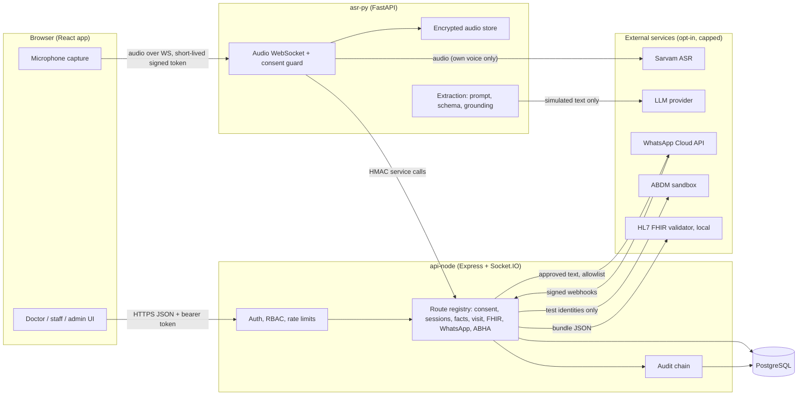

# Threat model (Phase 12B Run 1, ADR-D44)

Scope: the VaaniEHR research prototype as it is today (simulated data only, local development, Docker compose for the demo). ClinicOS is not touched. Method: STRIDE per component, then the top threats with the code or test that answers each. A mitigation is listed only if it points at a file or a test that exists. Anything that is not built is in **Residual risks**, not hidden.

> Not a penetration test and not a certification. Hosting, TLS and a real deployment are the owner's steps (docs/OWNER_ACTIONS.md).

## 1. Data flow

Trust boundaries: browser to api-node; browser to asr-py; asr-py to api-node (service HMAC); api-node/asr-py to every external service; both services to the database (api-node only: asr-py has no database).

## 2. Assets

| Asset | Where | Why it matters |
|---|---|---|
| Audio recordings | asr-py encrypted store (`apps/asr-py/app/storage.py`, AES-256-GCM, per-file data key wrapped by `AUDIO_MASTER_KEY`) | Voice of a person; retention limit and purge (`app/purge.py`) |
| Transcripts and extracted facts | PostgreSQL (`transcript_segment`, `extracted_fact`) | Health information; DB triggers guard them after withdrawal |
| Signed visit records and snapshots | PostgreSQL (`visit_version`, SHA-256 of the snapshot) | Medico-legal record; immutable once signed |
| Prescriptions | PostgreSQL | Patient safety |
| Keys and secrets | `.env` files (git-ignored): `DEV_AUTH_SECRET`, `INTERNAL_SERVICE_SECRET`, `AUDIO_MASTER_KEY`, provider keys | Forgery of tokens, decryption of audio, spend |
| ABHA data | `abha_link` (address, mode, salted hash), never the number or OTP (ADR-D42) | Identity linkage |
| Audit log | PostgreSQL, append-only hash chain (docs/AUDIT_CHAIN.md) | Accountability |
| Patient phone numbers | `patient` rows, WhatsApp log (last 4 digits only in the UI) | Contact data |

## 3. STRIDE per component

S spoofing, T tampering, R repudiation, I information disclosure, D denial of service, E elevation of privilege.

| Component | S | T | R | I | D | E |
|---|---|---|---|---|---|---|
| **Browser** | stolen bearer token (in memory only, never in storage: e2e checks browser storage) | modified client code cannot bypass the server checks (every gate is server side) | - | XSS reading the token: React escaping, no `dangerouslySetInnerHTML`, `security-static.test.ts`; Content-Security-Policy and HSTS on the static host (`apps/web/nginx.conf`, `security-static.test.ts`; hosts to edit at deployment, R-3) | - | hidden buttons are not security: RBAC is server side |
| **api-node** | JWT HS256 with issuer, audience, `jti`, expiry (`auth/DevAuthProvider.ts`); logout revocation; service HMAC with 60 s skew (`auth/serviceAuth.ts`) | zod validation on every body, `.strict()` objects; DB triggers; signed snapshot hash | audit row in the same transaction as every change (`audit/audit.ts`); refusals audited with `auditCommitted` | clinic scoping on every query; errors carry fixed words; log-redaction tests | login rate limit and lockout; JSON body limit 100 kb; sign throttle; ABHA OTP caps; webhook limit per address (`WEBHOOK_RATE_LIMIT_MAX`, `whatsapp/routes.ts`, `security.db.test.ts`); NUL characters refused (`http/noNul.ts`) | permission matrix `auth/permissions.ts` checked per route; `rbac.db.test.ts` covers every route; `clinic-isolation.db.test.ts` both ways |
| **asr-py** | WebSocket needs a signed short-lived token from api-node (`api-node/src/asr/token.ts`); service calls verified with HMAC | audio frames validated; extraction output schema-validated and grounded | usage log of every paid call | consent guard (`app/consent.py`); own-voice rule for paid audio (`app/own_voice.py`); audio encrypted at rest; logs carry no content | spend caps (`app/usage.py`, `app/extraction/llm_usage.py`), per-run caps, stream length cap | no shell, no file paths from clients, internal API only with the HMAC |
| **PostgreSQL** | app role `vaani_app` with least privilege; owner role used only for migrations | append-only audit grants; triggers for signed prescription, visit versions, withdrawn facts/transcripts | audit hash chain verifiable (`npm run verify:audit`) | no PHI in audit meta (guard regex in `audit/audit.ts`); backups are the owner's step | connection pool limits | grants tested in `schema.db.test.ts` |
| **Sarvam / LLM provider** | API keys in `.env`, `SecretStr` in settings, never logged | response treated as untrusted: schema, grounding, doctor confirms | usage log | only the owner's own voice and declared-simulated text leave the machine (`own_voice.py`, `simulated_text.py`); `SIMULATED_DATA_ONLY=false` refused (`config/env.ts`) | monthly and per-run caps | the model has no tools; output can only be a list of facts |
| **WhatsApp** | webhook HMAC-SHA256 signature, constant-time compare (`whatsapp/service.ts verifySignature`) | text approved by the doctor, hash stored, sent text must equal it | send log with provider ids | recipient allowlist; last 4 digits shown | limit per address before the signature check (`security.db.test.ts`) | real sending off by default (ADR-D41) |
| **ABDM** | sandbox credentials only in `.env`; mock by default (ADR-D42) | encrypted request values (`abdm/encryption.ts`) | audit rows without identifiers | number and OTP never stored or logged (`abha.db.test.ts` log-redaction test) | retry with backoff; per-patient start cap | identity guard refuses real-looking identities |
| **FHIR validator** | local container, no secret | bundle content is generated from the signed snapshot only | validation result stored with the bundle | no PHI leaves the machine | validator down = "not validated", never a silent pass | - |

## 4. Top 15 threats

| # | Threat | Mitigation (code / test) | Status |
|---|---|---|---|
| 1 | Forged or tampered bearer token | `DevAuthProvider` verifies signature, issuer, audience, expiry, `jti` shape; `auth.db.test.ts`, `security.db.test.ts` (tampered, wrong-secret, `alg:none`, expired) | covered |
| 2 | Role escalation (staff calling doctor routes) | `permissions.ts` + route registry; `rbac.db.test.ts`; `security.db.test.ts` (every route group x every role) | covered |
| 3 | Cross-clinic access (IDOR on patient, session, visit, bundle ids) | clinic scoping in every service; `clinic-isolation.db.test.ts`; `security.db.test.ts` (visit, bundle, summary ids) | covered |
| 4 | Credential guessing | per-IP rate limit, account lockout, bcrypt cost 12, no user enumeration (`auth.db.test.ts`, `login-privacy.db.test.ts`) | covered |
| 5 | Recording or processing without consent | consent checked at token issue and while streaming (`asr-token.db.test.ts`, `test_consent_guard.py`, `test_ws.py`); audio route without consent (`security.db.test.ts`) | covered |
| 6 | Audio disclosure at rest | AES-256-GCM per file, bound to the session id (`test_storage.py`); retention purge | covered (key custody is the owner's) |
| 7 | Prompt injection in a transcript (clip08) | system prompt treats the transcript as data (`prompts/extract_v1.md`); delimiters escaped; schema + grounding (`test_extraction.py`); injection-phrase filter and end-to-end test (`test_prompt_injection.py`); the doctor confirms every fact | covered, residual R-4 |
| 8 | Hallucinated or unsafe model output stored as fact | grounded quotes, `extracted_fact` starts unconfirmed, sign gate needs confirmed facts (`visit-sign.db.test.ts`) | covered |
| 9 | Altering a signed record | DB triggers, snapshot SHA-256, amendment creates a new version (`visit-mutation.db.test.ts`, `schema.db.test.ts`) | covered |
| 10 | Audit log tampering or silent gaps | append-only grants, hash chain, `verify:audit` (`audit-chain.test.ts`, `audit.db.test.ts`) | covered |
| 11 | Forged webhook / fake STOP or delivery status | HMAC signature before any parsing (`whatsapp.db.test.ts`, `whatsapp-mutation.db.test.ts`, `security.db.test.ts`) | covered, including flooding (rate limit) |
| 12 | Internal route abuse (fake asr-py calls) | HMAC with 60 s skew, body hash in the signature (`audio-asset.db.test.ts`) | covered, replay inside 60 s is R-5 |
| 13 | Secrets in logs, errors, audit, repository | `security-secrets.db.test.ts` (patterns in logs, audit, API errors), gitleaks in CI, `.gitignore`, config errors never echo values (`config.test.ts`) | covered |
| 14 | Cost abuse (paid ASR / LLM / WhatsApp) | monthly and per-run caps, `--yes-run`, simulated-data gate, allowlist (`test_usage.py`, `test_simulated_text.py`, `test_bench_runner.py`) | covered |
| 15 | Vulnerable dependency or image | `scripts/audit-gate.mjs` (npm audit, pip-audit), Trivy image scan, Semgrep and Bandit in `.github/workflows/security.yml` (ADR-D44); two findings fixed in this phase (body-parser high, vitest moderate) | covered; see ASVS_L1.md |

## 5. LLM threats (OWASP Top 10 for LLM applications, 2025)

| LLM risk | What exists here | Evidence |
|---|---|---|
| LLM01 Prompt injection | transcript is data inside escaped delimiters; the model has no tools and answers one JSON object; unknown keys rejected; injection-phrase filter drops facts that come from instruction-like lines; doctor confirms | `prompts/extract_v1.md`, `test_extraction.py`, `test_prompt_injection.py` |
| LLM02 Sensitive information disclosure | only declared-simulated text or the owner's own voice goes to a hosted model; `SIMULATED_DATA_ONLY=false` refused; no PHI in logs | `app/simulated_text.py`, `app/own_voice.py`, `config/env.ts`, `security-secrets.db.test.ts` |
| LLM05 Improper output handling | output validated against a strict schema, quotes must appear verbatim in the segment, facts rendered as text (React escapes), never executed | `app/extraction/models.py`, `grounding.py`, `security.xss.test.tsx` |
| LLM06 Excessive agency | the model cannot call tools, change records, prescribe or send; every fact, prescription and message needs a human action | extraction API returns facts only; sign and WhatsApp gates in `visits/`, `whatsapp/` |
| LLM10 Unbounded consumption | monthly rupee/token/request caps, per-run request cap, stream length cap, `--yes-run` for batch work | `app/usage.py`, `app/extraction/llm_usage.py`, `test_usage.py` |
| LLM03/04/07/08/09 supply chain, poisoning, prompt leakage, vector weaknesses, misinformation | no fine-tuning, no vector store, no secrets in prompts; the system prompt holds no secret; clinical suggestions are not generated by the model | architecture; risk accepted |

## 6. Residual risks (honest list)

| ID | Risk | Severity | Note |
|---|---|---|---|
| R-1 | No TLS in the local stack; cookies are not used (bearer in memory) | medium for a real deployment, none locally | owner: terminate TLS at the host (OWNER_ACTIONS) |
| R-2 | The webhook limit is per address: behind a proxy `TRUST_PROXY` must be set correctly or all callers share one address | low | owner at deployment (OWNER_ACTIONS) |
| R-3 | The Content-Security-Policy in `apps/web/nginx.conf` lists the local compose addresses in `connect-src`; the real https/wss host names must replace them, and HSTS only works over HTTPS | medium | owner at deployment (OWNER_ACTIONS) |
| R-4 | The injection filter covers English phrases; a Gujarati or Hindi injection can still reach the model (the model, schema, grounding and the doctor remain) | low | the doctor confirms every fact |
| R-5 | A service-signed request can be replayed inside its 60 s window | low | the internal routes are idempotent or guarded; a nonce store is not built |
| R-6 | Single `DEV_AUTH_SECRET` signs all tokens; no refresh tokens, no key rotation | accepted for standalone mode (ADR-D4) | Phase 12 replaces it with ClinicOS tokens |
| R-7 | Backups, disk encryption, and key custody are the owner's | owner | OWNER_ACTIONS |
| R-8 | No penetration test, no fuzzing campaign | info | out of scope for a prototype |
